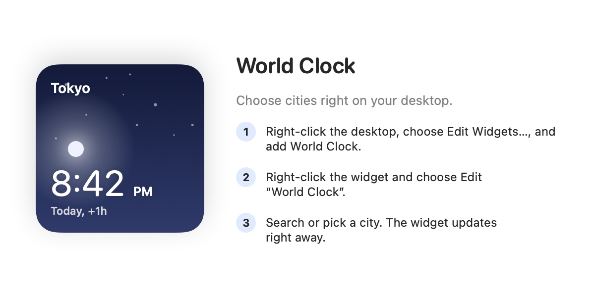

# World Clock Widget

<picture>
  <source media="(prefers-color-scheme: dark)" srcset="docs/brand/logo-dark.png">
  
</picture>

A native macOS desktop world clock with searchable cities, local times and a quiet day/night design.
Built with SwiftUI, WidgetKit and App Intents. No third-party runtime dependencies, network calls or background polling loop.


## Features

- **Small:** one city under a sky whose glowing sun or moon rises and sets with its local time.
- **Medium:** four cities in a 2×2 grid.
- **Large:** seven cities with aligned times and slim 24-hour day ribbons.
- Choose cities in the widget's own settings: English/Chinese search, or popular cities grouped by region with their current local times.
- System language and 12/24-hour preferences; DST-aware offsets and dates.
- Light, dark and system-managed monochrome widget appearances.

Day/night icons use approximate local clock-hour ranges, not astronomical sunrise or sunset data.

## Build and install

Requires an Apple Silicon Mac, macOS 27+, Xcode 27+ with its command-line tools selected, and [XcodeGen](https://github.com/yonaskolb/XcodeGen).

```sh
brew install xcodegen
./scripts/install.sh
```

The script generates the Xcode project, builds Release, checks the widget's compiled intent metadata,
and installs the app at `~/Applications/World Clock Widget.app`, removing an older `WorldClock.app` there. Local builds are ad-hoc signed and sandboxed;
an Apple Developer account is not required for this configuration.

Right-click the desktop → **Edit Widgets…** → search **World Clock**, then add a size.
Ordinary clicks on a widget do not open anything or flash an app icon in the Dock.

## Choosing cities

Right-click a widget → **Edit “World Clock”**. Type in **Search cities** to filter, then pick from the city list,
which otherwise shows popular cities grouped by region (your own region first) with each city's current time.
Each widget keeps its own cities; with none picked, it shows default cities in other time zones.

This is the only place cities are chosen. The **World Clock Widget** app exists only because macOS ships
widgets inside an app: it never appears in the Dock, and opening it just shows these steps next to a live
widget preview, then quits. Deleting the app removes the widget.



City IDs stay stable, so picks survive updates. Invalid cities are ignored and duplicates are removed
while preserving order.

## Develop and verify

```sh
./scripts/check.sh
```

This type-checks the framework-independent core, runs XCTest, builds Release, verifies compiled App Intent
metadata, and renders widget and app-window previews into `build/snapshots/`. Review those PNGs visually as well.
The generated `.xcodeproj` and build outputs are intentionally ignored.

```sh
# Refresh the screenshots in this README after reviewing them:
build/DerivedData.noindex/Build/Products/Debug/clock-snapshots docs --app-window
# Inspect widget registration and recent chronod activity:
./scripts/verify-widget.sh
```

After changes to rendering or intents, verify the installed widget too: select Los Angeles from a Mac in a
different time zone in Edit Widget, and confirm its local time and a minute tick.
Unit tests alone cannot reproduce the widget host's environment or macOS sandbox permissions.

## Architecture

| Directory | Responsibility |
| --- | --- |
| `Sources/Core/` | City lookup/search and regions, selection rules, time arithmetic/formatting and routes; Foundation only |
| `Sources/Presentation/` | Shared clock components, precomputed city snapshots and size-specific card layouts |
| `Sources/App/` | App lifecycle, launch policy and the help window |
| `Sources/Widget/` | Edit Widget configuration and city options, timeline provider and entry view |
| `Tests/` | Core behavior, widget configuration, city options and launch policy |
| `Snapshots/` | Deterministic rendering fixtures with a fixed instant |
| `scripts/` | Build checks, local installation and diagnostics |

See [architecture and invariants](docs/architecture.md) for data flow, compatibility boundaries and validation guidance.

The app icon and matching logos are in [`docs/brand/`](docs/brand/), with their
[image-generation prompts](docs/brand/prompts.json). `AppIconV2` contains the macOS icon exports;
the earlier icon assets are preserved. Logo masters are used only in documentation and are not bundled
with the app or widget.

## Resource use

Time digits update through the system's dynamic text with an explicit **per-city time-zone environment**.
The extension supplies 24 quarter-hour timeline entries for date labels, sky and ribbons, starting at the
actual request time. The app window updates its preview once a minute only while active.

Resolving a saved city initializes only the curated lookup or that specific IANA zone. The full searchable
catalog and normalized search index are lazy. Changing the visual design adds no animation timer.

Resource usage varies with macOS, widget sizes and process lifetime. RSS includes shared pages and should
not be described as exclusive memory. `vmmap -summary <extension-pid>` reports the extension's physical
footprint, which still excludes rendering performed in the system widget host. See
[verification notes](docs/verification.md) for measured results and limitations.

## Storage and signing

Each widget's cities are stored by macOS as part of that widget's configuration. The app and extension
store no files of their own and need no filesystem access beyond the standard sandbox.
Earlier versions wrote `~/Library/Application Support/WorldClockShared/city-selections.json`; it is no longer
read and can be deleted.

The Edit Widget picker persists stable city ID strings. AppEntity-based configuration is avoided because its
lookup needs a signing team, which ad-hoc builds do not have. Keep the `SelectCitiesIntent` parameter names
and types, bundle IDs and widget kind stable; `check-widget-metadata.py` checks the extracted schema.

For distribution, use appropriate signing and notarization. This repository's installation script is for local builds, not an
App Store distribution workflow.

With Pulse's Developer ID Application certificate and private key in the local keychain, run
`./scripts/sign-pulse.sh` to build and sign both the Release app and its widget with team `89G3DBC6CS`.
The signed app is at `build/Pulse.noindex/Build/Products/Release/WorldClock.app`; the ZIP is at
`build/distribution/WorldClock-Pulse.zip`. This script does not notarize the app or replace the installed copy.
Notarization is a separate step before public distribution.

Tag pushes matching `v*` run `.github/workflows/release.yml` on GitHub's Xcode 27 runner:
core checks and XCTest, Pulse signing, Apple notarization, ticket stapling and Gatekeeper assessment,
then a GitHub Release containing the ZIP and SHA-256 checksum.
The workflow requires repository secrets `PULSE_CERTIFICATE_P12` (base64-encoded PKCS#12)
and `PULSE_CERTIFICATE_PASSWORD`, plus the Pulse team API secrets `APPLE_API_KEY_P8`,
`APPLE_API_KEY_ID`, and `APPLE_API_ISSUER_ID`. Signing material is imported into a temporary
runner keychain; the original keychain search list is restored and private files are removed after the job.
New releases are published only after Apple accepts notarization, the ticket is stapled, and Gatekeeper passes.
The initial `v1.0.0` Actions build was notarized through local Xcode; `v1.0.1` uses cloud notarization.

To notarize a signed ZIP locally, run `./scripts/notarize-pulse.sh` with `NOTARY_KEYCHAIN_PROFILE`
and, for a dedicated keychain, `NOTARY_KEYCHAIN_PATH`. API keys are supported via
`APP_STORE_CONNECT_KEY_PATH`, `APP_STORE_CONNECT_KEY_ID`, and (for team keys) `APP_STORE_CONNECT_ISSUER_ID`.
See [AGENTS.md](AGENTS.md) for credential locations and release maintenance.
