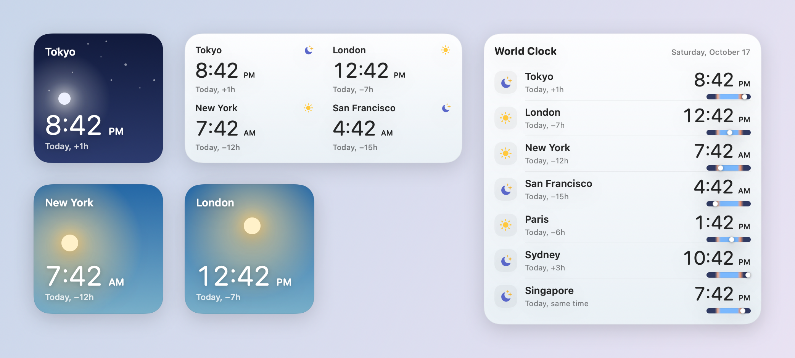
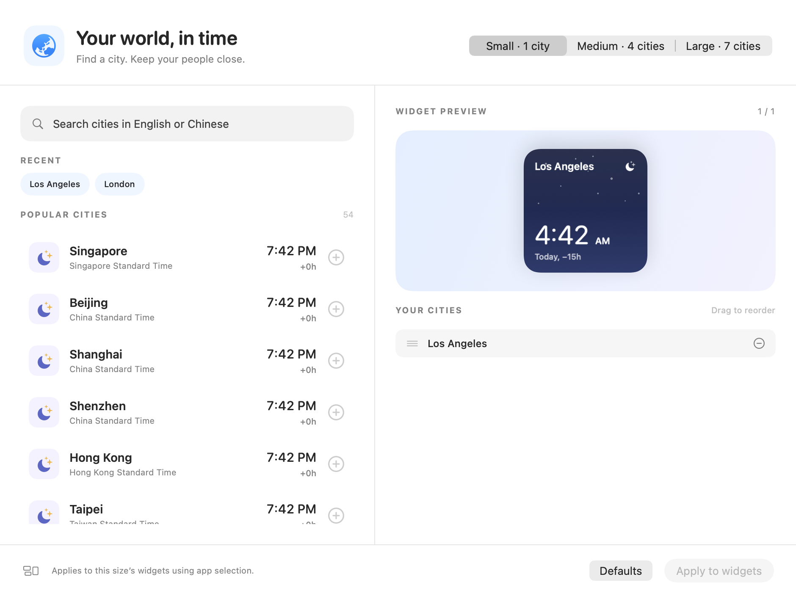

# World Clock Widget

A native macOS desktop world clock with searchable cities, local times and a quiet day/night design.
Built with SwiftUI, WidgetKit and App Intents. No third-party runtime dependencies, network calls or background polling loop.



## Features

- **Small:** one city, large time, sky gradient, time difference and local day.
- **Medium:** four cities in a 2×2 grid.
- **Large:** seven cities with aligned times and slim 24-hour day ribbons.
- Instant English/Chinese city search, recent selections, drag-to-reorder and live previews.
- System language and 12/24-hour preferences; DST-aware offsets and dates.
- Light, dark and system-managed monochrome widget appearances.

Day/night icons use approximate local clock-hour ranges, not astronomical sunrise or sunset data.

## Build and install

Requires an Apple Silicon Mac, macOS 27+, Xcode 27+ with its command-line tools selected, and [XcodeGen](https://github.com/yonaskolb/XcodeGen).

```sh
brew install xcodegen
./scripts/install.sh
```

The script generates the Xcode project, builds Release, checks the widget's compiled intent metadata,
and installs the app at `~/Applications/WorldClock.app`. Local builds are ad-hoc signed and sandboxed;
an Apple Developer account is not required for this configuration.

Right-click the desktop → **Edit Widgets…** → search **World Clock**, then add a size.
Ordinary clicks on a widget do not open the city selector. To edit the widget, right-click it and choose
**Edit “World Clock”**. Disable **Use app selection** to choose cities directly for that widget.
To edit shared lists with the larger searchable editor, explicitly open World Clock from Applications,
select cities, and choose **Apply to widgets**.
The app quits when its last window closes. Widgets continue to work without it.



## How selections work

**Use app selection** is enabled by default. Saved cities apply to all widgets of that size following the app.
Switching sizes in the editor preserves each size's unsaved draft until the app exits.
The editor's Apply button saves only the currently selected size.

To give one widget its own cities, right-click it → **Edit “World Clock”**, disable **Use app selection**,
and use the native city picker. Ordinary widget clicks leave the clock in place and do not change selections.
Shared lists remain available by explicitly opening the World Clock app.

Existing city IDs and the `city-selections.json` format remain compatible. Without a saved app selection,
the widget keeps its native configured cities, or uses defaults if none are valid. Empty or invalid selections
fall back to defaults; duplicates are removed while preserving order.

## Develop and verify

```sh
./scripts/check.sh
```

This type-checks the framework-independent core, runs XCTest, builds Release, verifies compiled App Intent
metadata, and renders widget/editor previews into `build/snapshots/`. Review those PNGs visually as well.
The generated `.xcodeproj` and build outputs are intentionally ignored.

```sh
# Refresh the screenshots in this README after reviewing them:
build/Build/Products/Debug/clock-snapshots docs --picker
# Inspect widget registration and recent chronod activity:
./scripts/verify-widget.sh
```

After changes to rendering or intents, verify the installed widget too: select Los Angeles from a Mac in a
different time zone, confirm its local time and a minute tick, and test both configuration modes.
Unit tests alone cannot reproduce the widget host's environment or macOS sandbox permissions.

## Architecture

| Directory | Responsibility |
| --- | --- |
| `Sources/Core/` | City lookup/search, selection rules, time arithmetic/formatting, routes and the persistence interface; Foundation only |
| `Sources/Storage/` | Atomic JSON storage and the local shared-directory location |
| `Sources/Presentation/` | Shared clock components, precomputed city snapshots and size-specific card layouts |
| `Sources/App/` | App lifecycle, editor state and focused SwiftUI editor views |
| `Sources/Widget/` | App Intent and WidgetKit adapters, timeline provider and entry view |
| `Tests/` | Core behavior, configuration, persistence failures and editor flows |
| `Snapshots/` | Deterministic rendering fixtures that never read the user's settings |
| `scripts/` | Build checks, local installation and diagnostics |

See [architecture and invariants](docs/architecture.md) for data flow, compatibility boundaries and validation guidance.

## Resource use

Time digits update through the system's dynamic text with an explicit **per-city time-zone environment**.
The extension supplies 24 quarter-hour timeline entries for date labels, sky and ribbons, starting at the
actual request time. The editor updates its previews once a minute only while active.

Resolving a saved city initializes only the curated lookup or that specific IANA zone. The full searchable
catalog and normalized search index are lazy. Changing the visual design adds no animation timer.

Resource usage varies with macOS, widget sizes and process lifetime. RSS includes shared pages and should
not be described as exclusive memory. `vmmap -summary <extension-pid>` reports the extension's physical
footprint, which still excludes rendering performed in the system widget host. See
[verification notes](docs/verification.md) for measured results and limitations.

## Local storage and signing

Settings live at `~/Library/Application Support/WorldClockShared/city-selections.json`.
The app has a narrow sandbox exception to write there; the extension has read-only access.
Only a missing settings file means first use. Read/permission/decoding errors are surfaced in the editor,
and saving refuses to overwrite an unreadable document. Widget rendering logs a read failure and falls
back to its configured/default cities so a timeline can still be displayed.

The native picker persists stable strings. Earlier experiments with AppEntity resolution failed for the
ad-hoc-signed extension because its entity lookup required a signing team. Keep the parameter names, types,
bundle IDs and widget kind stable; `check-widget-metadata.py` checks the relevant extracted schema.
Very old AppEntity-based widget configurations need one manual city reselection when upgrading.

For distribution, replace the local filesystem exceptions with a properly provisioned App Group and
appropriate signing/notarization. This repository's installation script is for local builds, not an
App Store distribution workflow.
