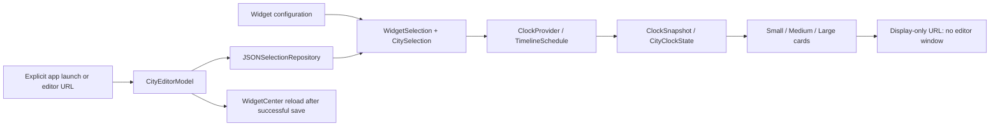

# Architecture and invariants

The code is organized by responsibility without introducing extra dynamic frameworks or third-party dependencies.
XcodeGen compiles the shared source groups into the app and widget targets. The core and editor model can be
validated without compiling the SwiftUI layouts; `scripts/check.sh` also type-checks the core on its own.

## Data flow

- `CityCatalog` resolves stable IDs without initializing the complete search catalog. Curated cities preserve
  their existing IDs. Other cities use `tz:` plus their IANA time-zone identifier.
- `CitySearch` initializes a normalized index on the first nonempty search. Exact names rank before name
  prefixes, substrings and zone-name matches. The editor caches results until its query changes.
- `WidgetSelection` defines precedence: valid IDs picked in the widget's own configuration, otherwise app settings
  for this size, otherwise defaults. The extension reads the settings file only when nothing valid is picked.
  `CitySelection` enforces validity, uniqueness, order and capacity.
- `SelectionSettings` retains the previous JSON shape and unknown size keys. The repository re-reads before
  each atomic save, preserving other sizes. Only the single host app writes settings; the widget only reads.
  Atomic replacement prevents partial documents but is not a general concurrent multi-writer transaction.
- Ordinary widget clicks use `worldclock://display`. AppKit owns window creation, so this route is consumed
  without creating an editor or initializing its model. A host launched solely for this route exits immediately.
  `LSUIElement = true` makes LaunchServices start the host without a Dock tile. Only `showEditor` promotes it
  to `.regular`. Setting the policy after launch would be too late to prevent the initial Dock flash.
  URL delivery can follow `applicationDidFinishLaunching`, especially on double-clicks. That callback must
  check `NSApplication.launchIsDefaultUserInfoKey` before treating a launch as an explicit editor request;
  the absence of an already-received URL alone is insufficient.
  macOS can still briefly launch the host; this prevents Dock presentation, not all process activity on a click.
  Explicitly opening the app still shows its editor. Right-click **Edit Widget** remains macOS's native configuration UI.
- `EditorRoute` carries size, ordered IDs and source for explicit or legacy editor links. Old links without a source are accepted as app links.
  Independent-widget routes are read-only in the app because the app cannot rewrite an installed instance's
  App Intent configuration. Switching to shared editing is explicit.
- `CityEditorModel` owns per-size drafts, capacity, ordering, save/error state and search results. Its repository
  and reload callback are injected. Opening or searching does not refresh WidgetKit; only a successful save does.
- Editor drafts remain in memory until the app exits. They are not autosaved. Existing drafts take priority over
  incoming links, and saved settings take priority over a link's potentially stale city list on first open.
- `CityClockState` computes a city's date difference, offset and day phase once per snapshot. All layouts consume
  that state. `ClockFormatting` respects locale and 12/24-hour preference without reading the host's default zone.
- `ClockTime` must apply both the format style's time zone and the SwiftUI time-zone environment for live digits.
  The widget host can otherwise render every city in the Mac's local zone. Preserve that environment modifier.
- `TimelineSchedule` provides an immediate entry and future quarter-hour boundaries, 24 entries per request.
  Sky phases are approximate; quarter-hour snapshots are appropriate for the supported current offsets and UI.
- The app's only periodic UI update is its active-window minute preview. The extension has no app-owned repeating
  timer. The app exits when its last window closes.

## Error and compatibility boundaries

A missing JSON file is normal first use. Other I/O and decoding failures propagate to the editor. A failed save
never reports success or triggers a widget reload, and corrupt JSON is not replaced with an empty configuration.
The widget must still return a timeline on read failure, so its adapter logs the error and uses the native/default
selection. The app provides the actionable error message when opened.

Keep these persisted contracts stable unless implementing an explicit migration:

- Bundle IDs and widget kind `com.ac1982.worldclock.cities`.
- `SelectCitiesIntent` parameter names and string value types.
- City IDs, size raw values and the settings file path/JSON keys.
- The `worldclock://cities` URL scheme, host and `family`/`city` query keys.

The local shared-directory exception is deliberately isolated in `SharedSettingsLocation` and target entitlements.
Moving to a signed App Group is a distribution change, not an incidental refactor. Existing settings would need a
migration if that storage location changes.

## Verification boundaries

Tests cover selection precedence, native picker IDs, normalization, legacy routes/settings, write/read failures,
corruption preservation, draft retention, ordering/capacity, reload-on-success, DST and midnight/date-line cases.
Snapshot fixtures use a fixed instant and fake repository, so documentation renders cannot change a real selection.

Release metadata checks catch intent schema changes that direct Swift tests do not. Rendered PNGs cover all sizes,
English/Chinese and light/dark modes. Actual desktop checks remain required for sandbox access, widget registration,
dynamic time-zone behavior, monochrome rendering, passive clicks and explicit editor launch.

Apple documents the default widget-to-app launch behavior in [Linking to specific app scenes](https://developer.apple.com/documentation/widgetkit/linking-to-specific-app-scenes-from-your-widget-or-live-activity).
The startup policy follows Apple's [LSUIElement](https://developer.apple.com/documentation/bundleresources/information-property-list/lsuielement)
and [default-launch notification key](https://developer.apple.com/documentation/appkit/nsapplication/launchisdefaultuserinfokey) documentation.
