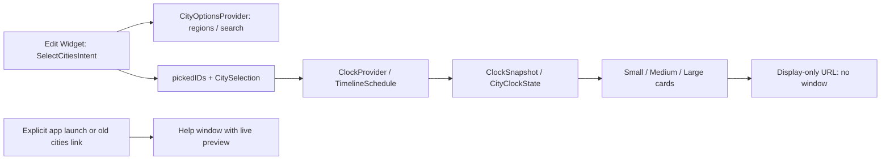

# Architecture and invariants

The code is organized by responsibility without introducing extra dynamic frameworks or third-party dependencies.
XcodeGen compiles the shared source groups into the app and widget targets. The core and widget configuration can be
validated without compiling the SwiftUI layouts; `scripts/check.sh` also type-checks the core on its own.

## Data flow

- Cities are chosen only in Edit Widget. `SelectCitiesIntent.pickedIDs` returns the single city for small widgets
  and the list for larger ones, falling back to the other parameter so resizing keeps a pick. `CitySelection`
  enforces validity, uniqueness, order and capacity, and falls back to defaults in other time zones.
- `CityOptionsProvider` supplies the picker: popular cities grouped by `CityRegion` with the user's own region first,
  or flat search results. Each row's subtitle shows the city's current time and difference from local time.
- `CityCatalog` resolves stable IDs without initializing the complete search catalog. Curated cities preserve
  their existing IDs. Other cities use `tz:` plus their IANA time-zone identifier.
- `CitySearch` initializes a normalized index on the first nonempty search. Exact names rank before name
  prefixes, substrings and zone-name matches.
- Ordinary widget clicks use `worldclock://display`. AppKit owns window creation, so this route is consumed
  without creating a window. A host launched solely for this route exits immediately.
  `LSUIElement = true` makes LaunchServices start the host without a Dock tile, and the app never changes that:
  it only hosts the widget, and its one window is a short note. Setting the policy after launch would be too late
  to prevent the initial Dock flash.
  URL delivery can follow `applicationDidFinishLaunching`, especially on double-clicks. That callback must
  check `NSApplication.launchIsDefaultUserInfoKey` before treating a launch as an explicit request;
  the absence of an already-received URL alone is insufficient.
  macOS can still briefly launch the host; this prevents Dock presentation, not all process activity on a click.
- `EditorRoute` recognizes `worldclock://cities` links from earlier versions; they now just open the app window.
  Older links may carry `source=app` or `source=widget`; the value is ignored, and any other value rejects the link.
- `CityClockState` computes a city's date difference, offset and day phase once per snapshot. All layouts consume
  that state. `ClockFormatting` respects locale and 12/24-hour preference without reading the host's default zone.
- `ClockTime` must apply both the format style's time zone and the SwiftUI time-zone environment for live digits.
  The widget host can otherwise render every city in the Mac's local zone. Preserve that environment modifier.
- `TimelineSchedule` provides an immediate entry and future quarter-hour boundaries, 24 entries per request.
  Sky phases are approximate; quarter-hour snapshots are appropriate for the supported current offsets and UI.
- The app's only periodic UI update is its active-window minute preview. The extension has no app-owned repeating
  timer. The app exits when its last window closes.

## Compatibility boundaries

Keep these persisted contracts stable unless implementing an explicit migration:

- Bundle IDs and widget kind `com.ac1982.worldclock.cities`.
- `SelectCitiesIntent` parameter names (`search`, `location`, `locations`) and string value types.
- City IDs and size raw values.
- The `worldclock://cities` URL scheme and host.

## Verification boundaries

Tests cover configuration precedence and resizing, picker IDs, region grouping, row subtitles, search ranking,
normalization, legacy routes, launch ordering, DST and midnight/date-line cases. Snapshot fixtures use a fixed instant.

Release metadata checks catch intent schema changes that direct Swift tests do not. Rendered PNGs cover all sizes,
English/Chinese and light/dark modes. Actual desktop checks remain required for widget registration, the Edit Widget
picker, dynamic time-zone behavior, monochrome rendering, passive clicks and explicit app launch.

Apple documents the default widget-to-app launch behavior in [Linking to specific app scenes](https://developer.apple.com/documentation/widgetkit/linking-to-specific-app-scenes-from-your-widget-or-live-activity).
The startup policy follows Apple's [LSUIElement](https://developer.apple.com/documentation/bundleresources/information-property-list/lsuielement)
and [default-launch notification key](https://developer.apple.com/documentation/appkit/nsapplication/launchisdefaultuserinfokey) documentation.
